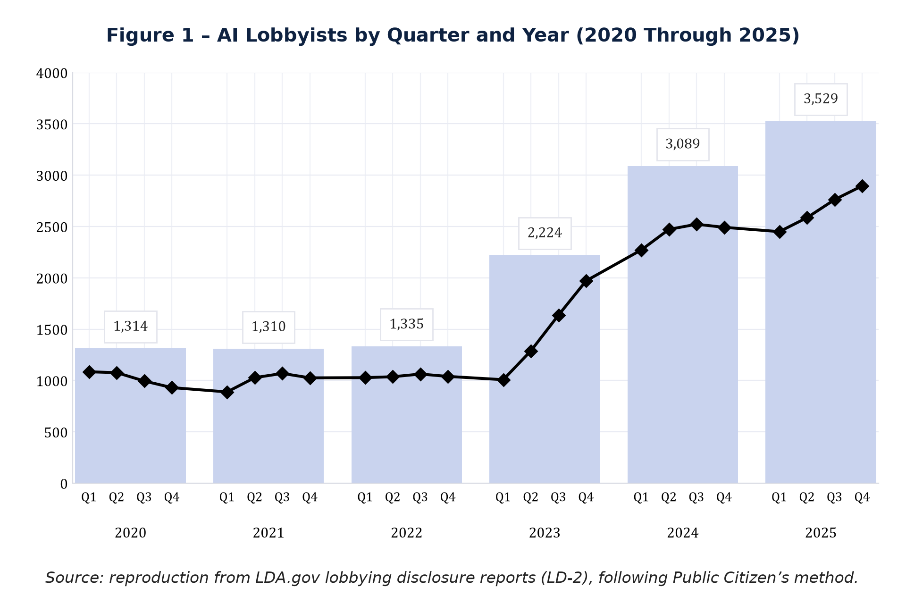
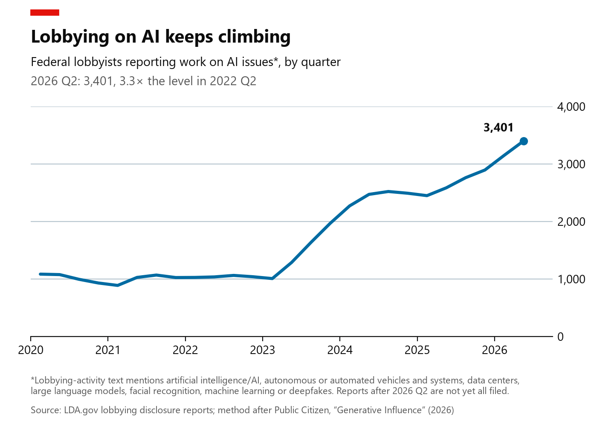

# ps158-reproduce: AI lobbyists by quarter and year

POLISCI 158, Section Assignment 3 (Option A).

## Which figure

Public Citizen, *[Generative Influence](https://www.citizen.org/article/generative-influence/)*
(Mike Tanglis and Eileen O'Grady, February 24, 2026), **Figure 1: AI Lobbyists by Quarter and
Year (2020 Through 2025)**, shown in Session 4, "Demand Side II: Firms, Platforms, and
Lobbying", on the slide "AI lobbying grew — what are we counting?". Bars show the number of
people who lobbied on AI issues at least once in each year; the line shows the count in each
quarter.



## Where the data come from

Quarterly lobbying reports (form LD-2) filed under the Lobbying Disclosure Act. `get_data.py`
downloads them from the [LDA.gov API](https://lda.gov/api/v1/filings/), the joint House–Senate
lobbying database. Public Citizen used the same filings from the House Clerk's site, which has
since moved to LDA.gov. Downloaded October 14–15, 2026.

## How it is built

Following the report's methodology section:

1. **Which filings.** Quarterly reports (amendments and terminations included, registrations
   left out). When a report was amended, only its latest version counts.
2. **What counts as AI lobbying.** A lobbying activity whose own description mentions
   artificial intelligence (or AI / A.I.), autonomous vehicles or systems, data centers, large
   language models or facial recognition. The report also searched "variations of those words"
   and "a handful of other AI terms" without listing them. So I added other autonomous and
   automated-vehicle wording (autonomous, automated vehicles, self-driving, driverless),
   machine learning and deepfakes. "AI/AN" (American Indian/Alaska Native) is excluded.
3. **Who counts.** Every lobbyist listed on a matching activity, counted once per quarter and
   once per year. People are identified by first and last name, so someone working for several
   firms counts once.

## How close it is

| Year | Published (Table 1) | Reproduced | Difference |
|---|---:|---:|---:|
| 2020 | 1,311 | 1,314 | +0.2% |
| 2021 | 1,269 | 1,310 | +3.2% |
| 2022 | 1,332 | 1,335 | +0.2% |
| 2023 | 2,210 | 2,224 | +0.6% |
| 2024 | 3,101 | 3,089 | −0.4% |
| 2025 | 3,570 | 3,529 | −1.1% |

The largest gap is 2021 (+3.2%). The report doesn't publish its quarterly numbers, so the
quarterly line can only be compared to the original figure by eye; it follows the same path,
including the dip in early 2021 and the jump through 2023.

**Checks I ran:**
- **Terms used.** With only the terms the report names, every year comes out 4–10% low (the
  `lobbyists_named_terms` column). Most of the gap is autonomous-vehicle filings that say
  "automated vehicles" or "self-driving" instead.
- **Share of AI wording.** In 2025, 89% of the lobbyists I count match on AI wording itself.
  The report says 90%.
- **Data-center subset** (the report's Figure 2): 66, 61, 72, 78, 153 and 402 lobbyists in
  2020–2025, against 61, 57, 68, 74, 153 and 406 published.
- **Lobbyists per client** (Table 2, 2025): 12 of the 16 clients I checked match exactly
  (Meta 55, Amazon 48, Scale AI 44, NVIDIA 28, ...). The other four are within 1–4 lobbyists.
  For Google and IBM, this only works after merging subsidiaries (Waymo, Red Hat), as the
  report did.
- **Spot checks.** I re-downloaded three matched filings directly from LDA.gov; the
  description and lobbyists matched the CSV.
- **Clean rebuild.** Deleting the outputs and rebuilding from the downloaded data gives
  identical files.

**Caveats:**
- **Missing term list.** Public Citizen's exact search terms aren't published, so step 2 is
  my best reading of the methodology.
- **Live database.** LDA.gov keeps receiving late filings and amendments, so the counts can
  drift slightly over time.

## Bonus: brought up to 2026, in The Economist's style



Same count, extended from 2025 Q4 to 2026 Q2 and restyled as an Economist chart, with a
headline stating the finding. AI-issue lobbying didn't level off: 3,401 people reported it in
2026 Q2, a record and 3.3 times the 2022 Q2 level, nearly as many in one quarter as in all of
2025 (3,529). 2026 Q3 is left off because those reports aren't due until October 20, 2026.

## Files

| File | What it is |
|---|---|
| `get_data.py` | Downloads the filings from LDA.gov and builds the two CSVs |
| `plot.py` | Draws `figure.png` (reproduction) and `figure_extension.png` (bonus), and prints the comparison table |
| `data/ai_lobbyists_by_quarter.csv` | Unique AI-issue lobbyists, clients and reports per quarter and year, 2020–2026 (2026 Q3 and the 2026 total are still incomplete) |
| `data/ai_lobbying_activities.csv` | Every matching lobbying activity, with client, matched terms, lobbyists and text |
| `state_ai_bills/` | An earlier exploration, not part of the assignment: NCSL state AI bills 2019–2026, plus Public Citizen's deepfake tracker and OECD.AI policies |

## How to rerun

```bash
python -m venv .venv
.venv\Scripts\python -m pip install -r requirements.txt
.venv\Scripts\python get_data.py
.venv\Scripts\python plot.py
```

On macOS or Linux, use `.venv/bin/python` instead of `.venv\Scripts\python`.

LDA.gov rate-limits anonymous requests, so the first `get_data.py` run takes about an hour;
downloads are cached in `data/raw/` (not committed), and `get_data.py --from-raw` rebuilds the
CSVs from that cache in under a minute. A free [LDA.gov API key](https://lda.gov/api/register/)
in the `LDA_API_KEY` environment variable makes the download faster.
